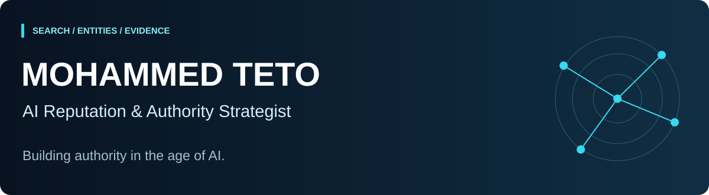

  

# Mohammed Teto
**AI Reputation & Authority Strategist · Working internationally**

I help **leaders and organizations** strengthen how they are discovered, understood and represented across **web search and generative AI**—through clear identity, verifiable evidence and credible sources.

**SEO · AEO · GEO · Entity Optimization · AI Search Intelligence**

  
  
  

[For leaders](https://mohammedteto.com/leaders/) · [For organizations](https://mohammedteto.com/organizations/) · [Explore the method](https://mohammedteto.com/method/)

## Start with the method

[**Authority Architecture System →**](https://github.com/mhdteto/authority-architecture-system)  
The public operating companion to my six-layer method: perception, narrative, entity, evidence, search optimization and governance. Includes templates, a measurement protocol and a fictional worked example.

## Audit → Structure → Measure

Public tools and working materials for a documented, repeatable review. Choose the part of the problem you need to examine.

### 01 · Audit the foundations

- [**Search & AI Discoverability Checker**](https://github.com/mhdteto/search-ai-discoverability-checker) — inspect a public page's technical signals, including robots directives, canonicals, JSON-LD and one sitemap. A technical observation, not an indexation or AI-visibility verdict.
- [**Entity Consistency Auditor**](https://github.com/mhdteto/entity-consistency-auditor) — compare supplied profile observations with an approved identity record across languages and markets. Offline; no automatic identity verification.

### 02 · Structure the identity and evidence

- [**Authority Evidence Mapper**](https://github.com/mhdteto/authority-evidence-mapper) — map claims to supplied evidence reviews, including contrary evidence and review gaps. Human reviewers assess support.
- [**Entity Structured Data Kit**](https://github.com/mhdteto/entity-structured-data-kit) — five connected JSON-LD examples and an offline educational validator for a defined structural subset.

### 03 · Measure explicit observations

- [**AI Citation Tracker**](https://github.com/mhdteto/ai-citation-tracker) — analyze imported answers and explicit citation URLs, keeping engine, model, interface, language and market separate. Export HTML, CSV and JSON; no live AI queries.
- [**Measurement protocol**](https://github.com/mhdteto/authority-architecture-system/blob/main/docs/measurement-protocol.md) — define prompts, dates, sampling conditions and comparability before interpreting a change.

## Research and field guides

[International Reputation Source Map](https://github.com/mhdteto/international-reputation-source-map) · [Executive Authority Playbook](https://github.com/mhdteto/executive-authority-playbook)

[AI Visibility Audit Kit](https://github.com/mhdteto/ai-visibility-audit-kit) · [GEO Prompt Audit Dashboard](https://github.com/mhdteto/geo-prompt-audit-dashboard) · [llms.txt Generator](https://github.com/mhdteto/llms-txt-generator) · [Morocco research](https://github.com/mhdteto/llm-visibility-morocco)

Examples are labeled as fictional where applicable. These resources illustrate methods and technical work, not client outcomes or guaranteed rankings, AI citations or recommendations. A source URL or a clean structural report alone does not establish that a claim is true.

## Work with me

For an international leader or organization facing fragmented identity, weak source evidence or inconsistent representation in search and AI, the starting point is a **Private Authority Assessment**: a scoped review and a prioritized roadmap.

[**Discuss your project →**](https://mohammedteto.com/private-assessment/) · [Read the research](https://mohammedteto.com/research/) · [contact@mohammedteto.com](mailto:contact@mohammedteto.com)

Enterprise technology background, with experience advising business decision-makers. This is my independent advisory practice and public research.

**Casablanca, Morocco · International engagements · English & French**
